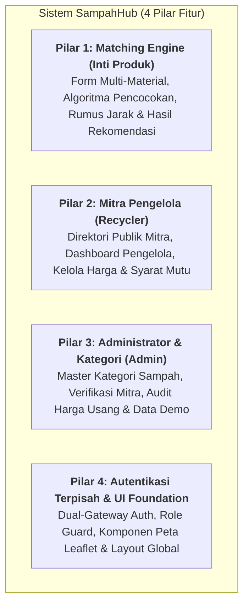

# PEMBAGIAN FITUR DAN JOBDESK TIM PENGEMBANGAN SAMPAHHUB (4 ORANG)

Dokumen ini memuat pembagian ruang lingkup fitur (*Feature Breakdown*), alokasi tanggung jawab pekerjaan (*Jobdesk Allocation*), matriks folder, serta alur kolaborasi untuk **tim pengembang 4 orang** pada proyek **SampahHub**.

---

## 1. Prinsip Pembagian Tugas (*Vertical Slice*)

Karena sistem SampahHub telah dirancang menggunakan **Modular Layered Architecture (*Package-by-Feature*)**, tim mengadopsi pola kerja **Vertical Slice**:
* Setiap anggota tim memegang satu domain fitur secara utuh dari **Frontend (Tampilan UI)** hingga **Backend (API & Query Database)**.
* **Bebas Bentrok (*Zero Git Merge Conflict*):** Setiap developer mengerjakan folder modul backend dan folder rute frontend yang berbeda, sehingga pekerjaan dapat dikerjakan secara paralel tanpa saling menunggu.

---

## 2. Rincian 4 Pilar Fitur Utama SampahHub



---

## 3. Matriks Alokasi Anggota Tim

| Anggota Tim | Domain Tanggung Jawab | Scope Backend | Scope Frontend | Tabel Database Terkait |
| :--- | :--- | :--- | :--- | :--- |
| **Orang 1 (Kamu / Lead)** | **Core Matching Engine & Results** | `src/modules/matching/` | `app/(matching)/` & `components/matching/` | `matching_sessions`, `matching_items`, `matching_results`, `matching_assignments` |
| **Orang 2 (Dev A)** | **Mitra Pengelola (Recycler)** | `src/modules/recyclers/` | `app/(dashboard)/recycler/` & `app/(public)/recyclers/` | `recyclers`, `recycler_materials`, `price_histories` |
| **Orang 3 (Dev B)** | **Admin & Master Data Kategori** | `src/modules/admin/` & `src/modules/waste/` | `app/(dashboard)/admin/` & `app/(public)/categories/` | `waste_categories`, `admins` (verifikasi mitra) |
| **Orang 4 (Dev C)** | **Autentikasi Terpisah, Peta & UI Core** | `src/modules/auth/` & `src/middlewares/` | `app/(auth)/`, `components/maps/`, `components/layout/` | `users`, `admins` (login internal) |

---

## 4. Rincian Jobdesk Masing-Masing Anggota

### 👤 Orang 1 (Kamu / Tech Lead)
**Fokus Utama:** Menggarap fitur pembeda utama (*Unique Value Proposition*) SampahHub: Mesin Pencocokan Multi-Material dan Halaman Hasil Rekomendasi.

#### Tanggung Jawab Backend:
* Folder: `backend/src/modules/matching/`
* Mengimplementasikan 4 sub-algoritma pencocokan:
  1. `eligibility.service.ts`: Filter kelayakan material, kecocokan satuan, dan batas minimum kuantitas (`min_quantity`).
  2. `combination.service.ts`: Penyusunan skenario 1 titik singgah (*Single Recycler*) dan partisi 2..N titik singgah (*Multi-Recycler Partition*).
  3. `distance.service.ts`: Implementasi rumus Haversine untuk menghitung estimasi jarak garis lurus dari lokasi pengguna ke pengelola.
  4. `scoring.service.ts`: Normalisasi skor Nilai Ekonomi ($E$), Jarak ($D$), Efisiensi Titik ($S$), dan pembobotan sesuai 4 prioritas (*Balanced*, *Highest Value*, *Nearest Location*, *Fewest Stops*).
* Menyimpan sesi dan snapshot harga di `matching.repository.ts`.
* Handler HTTP di `matching.controller.ts` & `matching.routes.ts` (`POST /api/matching`).

#### Tanggung Jawab Frontend:
* Folder: `frontend/app/(matching)/` dan `frontend/components/matching/`
* `app/(matching)/match/page.tsx`: Form dinamis input 1–5 jenis sampah, kuantitas, auto-satuan, catatan mutu, tombol GPS browser, dan radio selector prioritas.
* `app/(matching)/match/results/[sessionId]/page.tsx`: Halaman perbandingan alternatif (Rank #1, #2, dst.), rincian tempat singgah (*stops*), estimasi pendapatan rupiah, breakdown skor, dan catatan transparansi harga indikatif.

---

### 👤 Orang 2 (Fullstack Developer A - Mitra Recycler Specialist)
**Fokus Utama:** Menggarap seluruh alur mitra penerima sampah (Bank Sampah, Pengepul, TPS3R, Industri Daur Ulang) dari sisi publik maupun dashboard privat.

#### Tanggung Jawab Backend:
* Folder: `backend/src/modules/recyclers/`
* `recycler.controller.ts`, `recycler.service.ts`, dan `recycler.repository.ts`.
* Endpoint direktori publik: `GET /api/recyclers` (dengan query filter jenis pengelola) dan `GET /api/recyclers/:id`.
* Endpoint dashboard pengelola: Update profil alamat, koordinat latitude & longitude, dan nomor kontak.
* Endpoint pengelolaan material: CRUD ketentuan material yang diterima pengelola (`recycler_materials`), harga beli per satuan, minimum kuantitas, syarat mutu, dan update timestamp `price_updated_at`.

#### Tanggung Jawab Frontend:
* Folder: `frontend/app/(public)/recyclers/` dan `frontend/app/(dashboard)/recycler/`
* `app/(public)/recyclers/page.tsx`: Halaman direktori pencarian pengelola publik dengan fitur filter dropdown (*Bank Sampah, Pengepul, TPS3R, Industri*) dan search bar.
* `app/(public)/recyclers/[id]/page.tsx`: Halaman detail profil satu pengelola lengkap dengan peta lokasi dan daftar harga beli materialnya.
* `app/(dashboard)/recycler/page.tsx`: Overview status penerimaan dan badge status verifikasi mitra.
* `app/(dashboard)/recycler/profile/page.tsx`: Form edit profil, alamat fisik, dan pinpoint koordinat peta.
* `app/(dashboard)/recycler/materials/page.tsx`: Form kelola harga material yang diterima dan syarat mutunya.

---

### 👤 Orang 3 (Fullstack Developer B - Admin & Master Data Specialist)
**Fokus Utama:** Menggarap panel pengawasan administrator dan manajemen data master kategori sampah.

#### Tanggung Jawab Backend:
* Folder: `backend/src/modules/waste/` dan `backend/src/modules/admin/`
* **Modul Waste:**
  * `waste.controller.ts`, `waste.service.ts`, `waste.repository.ts`.
  * Endpoint master kategori sampah: `GET /api/waste/categories` dan CRUD kategori.
* **Modul Admin:**
  * `admin.controller.ts`, `admin.service.ts`, `admin.repository.ts`.
  * Endpoint verifikasi mitra: `POST /api/admin/recyclers/:id/verify` (status: `verified` atau `rejected`).
  * Endpoint audit harga usang: Query mitra yang belum memperbarui harga melewati batas waktu tertentu.

#### Tanggung Jawab Frontend:
* Folder: `frontend/app/(public)/categories/` dan `frontend/app/(dashboard)/admin/`
* `app/(public)/categories/page.tsx`: Halaman edukasi jenis sampah daur ulang, kisaran harga pasar, dan panduan pemilahan untuk masyarakat.
* `app/(dashboard)/admin/page.tsx`: Overview metriks platform (total mitra aktif, total kategori, antrean verifikasi).
* `app/(dashboard)/admin/verifications/page.tsx`: Tabel antrean verifikasi pendaftaran mitra baru dengan tombol persetujuan (*Approve / Reject*).
* `app/(dashboard)/admin/categories/page.tsx`: Antarmuka manajemen kategori sampah dan satuan resminya.
* `app/(dashboard)/admin/price-audit/page.tsx`: Tabel pantauan mitra dengan harga usang (*stale price monitoring*).

---

### 👤 Orang 4 (Fullstack Developer C - Autentikasi, UI Core & Peta Leaflet)
**Fokus Utama:** Menggarap sistem keamanan autentikasi terpisah, komponen dasar UI aplikasi, dan modul peta.

#### Tanggung Jawab Backend:
* Folder: `backend/src/modules/auth/` dan `backend/src/middlewares/`
* **Sistem Autentikasi Terpisah (*Dual-Gateway*):**
  * Registrasi dan Login Warga (`POST /api/auth/register`, `POST /api/auth/login`) $\rightarrow$ Khusus tabel `users`.
  * Login Admin Internal (`POST /api/admin/login`) $\rightarrow$ Khusus tabel `admins` terpisah.
* Password hashing menggunakan `bcrypt`.
* Pembuatan dan verifikasi token JSON Web Token (JWT).
* Middleware proteksi: `auth.middleware.ts` (verifikasi token) dan `role.middleware.ts` (guard akses role).

#### Tanggung Jawab Frontend:
* Folder: `frontend/app/(auth)/`, `frontend/components/maps/`, `frontend/components/layout/`, dan `frontend/components/ui/`
* `app/(auth)/login/page.tsx` & `register/page.tsx`: Form login dan registrasi akun warga dan pilihan peran.
* `app/page.tsx`: Desain Landing Page utama pengenalan SampahHub, cara kerja, dan tombol CTA.
* `components/layout/`: Navbar navigasi global dan Footer.
* `components/shared/`: Komponen `DemoBanner.tsx` untuk menampilkan label data simulasi/DEMO secara transparan.
* `components/maps/LeafletMap.tsx`: Setup komponen peta interaktif Leaflet (OpenStreetMap) menggunakan dynamic import CSR agar dapat dipakai oleh Orang 1 (rute hasil matching) dan Orang 2 (pinpoint lokasi mitra).

---

## 5. Alur Kerja Git & Kolaborasi Tim

Untuk mencegah konflik kode di repositori Git:

### 5.1 Strategi Percabangan (*Git Branching Strategy*)
```text
main (Stabel / Siap Deploy)
 └── staging (Tempat Gabungan Fitur untuk Pengujian)
      ├── feature/matching-engine    --> Dikerjakan oleh Orang 1
      ├── feature/recycler-module    --> Dikerjakan oleh Orang 2
      ├── feature/admin-waste        --> Dikerjakan oleh Orang 3
      └── feature/auth-core-ui       --> Dikerjakan oleh Orang 4
```

### 5.2 Aturan Kolaborasi:
1. Setiap anggota tim membuat *branch* baru dari `staging`.
2. Jangan mengedit file di luar folder modul/rute yang menjadi tanggung jawab sendiri.
3. Selalu jalankan `npx tsc --noEmit` di folder `backend/` dan `frontend/` sebelum melakukan *commit* untuk memastikan tidak ada kesalahan tipe data.
4. Lakukan *Pull Request* (PR) ke branch `staging` untuk pengujian integrasi bersama.

---

## 6. Rencana Timeline Eksekusi (Target 7 Hari MVP)

| Hari | Target Pekerjaan Tiap Anggota | Target Milestone Tim |
| :---: | :--- | :--- |
| **Hari 1** | • Orang 4: Setup Auth & Layout global.<br>• Orang 3: Seeder kategori sampah.<br>• Orang 2: Seeder data mitra demo.<br>• Orang 1: Siapkan kerangka matching. | Fondasi database & project siap jalan di lokal semua anggota. |
| **Hari 2** | • Orang 2: Selesaikan CRUD profil & material recycler.<br>• Orang 3: Selesaikan halaman kategori & verifikasi admin.<br>• Orang 4: Selesaikan integrasi login/register.<br>• Orang 1: Mulai coding `EligibilityService`. | Seluruh data master dan akun selesai. |
| **Hari 3** | • Orang 1: Selesaikan `CombinationService` & `DistanceService` (Haversine).<br>• Orang 2: Selesaikan direktori pengelola publik.<br>• Orang 3: Selesaikan dashboard admin & audit harga.<br>• Orang 4: Selesaikan komponen peta Leaflet. | Layanan pendukung siap dihubungkan ke Matching Engine. |
| **Hari 4** | • Orang 1: Selesaikan `ScoringService` & API `/api/matching`.<br>• Orang 2 & 3: Bantu testing data simulasi.<br>• Orang 4: Pasang peta Leaflet ke direktori pengelola. | Logika backend Matching Engine 100% selesai dan teruji. |
| **Hari 5** | • Orang 1: Hubungkan Form Matching Frontend ke API.<br>• Orang 1 & 4: Tampilkan rute titik singgah di peta Leaflet.<br>• Orang 2 & 3: Polishing dashboard masing-masing. | Alur Warga dari input sampah sampai hasil kartu rute berjalan end-to-end. |
| **Hari 6** | • Seluruh Tim: Pengujian bersama (*Integration Testing*), pengujian kasus ekstrim (misal: kuantitas di bawah minimum, sampah tidak diterima), dan perbaikan bug. | Sistem stabil tanpa error kompilasi dan bug mayor. |
| **Hari 7** | • Seluruh Tim: Polishing UI, memastikan badge DEMO terpasang transparan, persiapan skenario presentasi dan demo aplikasi. | MVP SampahHub siap dipresentasikan. |

