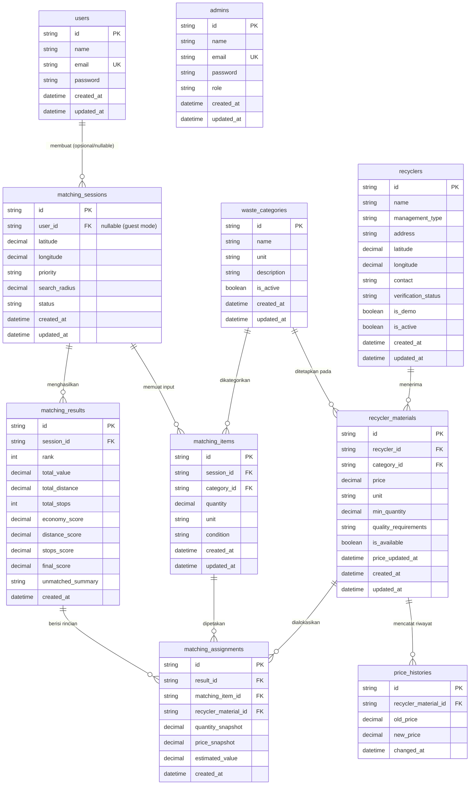
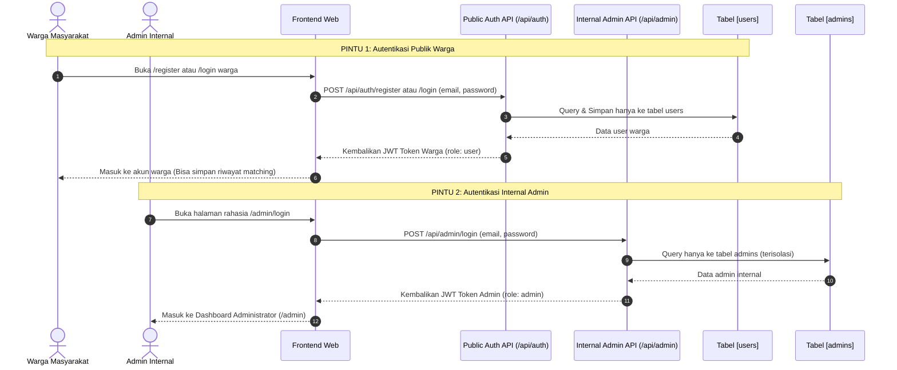
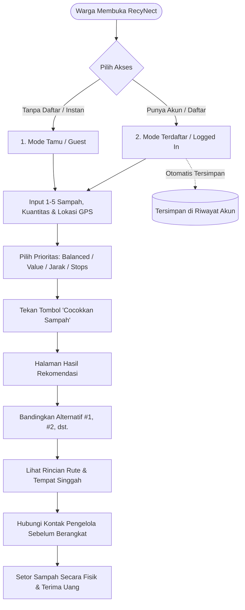

# PANDUAN STRUKTUR, ARSITEKTUR, ERD, DAN ALUR SISTEM RECYNECT

Dokumen ini merupakan panduan arsitektur teknis lengkap untuk aplikasi **RecyNect** yang mencakup:
* **Arsitektur Perangkat Lunak & Struktur Folder**
* **Diagram Relasi Entitas Database (ERD)**
* **Alur Sistem Autentikasi Terpisah (*Dual-Gateway Auth*)**
* **Alur Peran Pengguna (*User Flow* untuk Warga, Mitra, dan Admin)**
* **Alur Kerja Internal Sistem (*Matching Engine System Flow*)**

---

## 1. Nama & Pola Arsitektur Resmi

RecyNect dirancang mengikuti standar industri rekayasa perangkat lunak modern:

1. **Arsitektur Backend:**
   > **Modular Layered Architecture** *(Package-by-Feature)*
   
   Kode dikelompokkan berdasarkan modul domain fungsional (`auth`, `waste`, `recyclers`, `matching`, `admin`). Setiap modul bersifat otonom (*High Cohesion*) dan memiliki ketergantungan minimal dengan modul lain (*Low Coupling*), sehingga mencegah efek domino error ke seluruh sistem.

2. **Pola Desain di Setiap Modul Backend:**
   > **Controller – Service – Repository Pattern** *(3-Tier Layered Pattern)*
   * **Controller Layer:** Menangani HTTP request, validasi skema payload via Zod, dan mengembalikan HTTP response JSON.
   * **Service Layer:** Otak logika bisnis (*business logic*), orkestrasi algoritma pencocokan multi-material, kalkulasi jarak, dan pembobotan skor.
   * **Repository Layer:** Satu-satunya lapisan yang berkomunikasi langsung dengan database MySQL (Prisma Client).

3. **Prinsip Keamanan Akun (Isolasi Fisik Database):**
   > **Physical Separation of Privileged Accounts** *(Tabel `users` vs `admins` Dipisah Secara Fisik)*
   
   Untuk menjamin **keamanan absolut (*Zero Trust*)** dan mencegah risiko *Privilege Escalation* (kebocoran akun admin akibat bug query atau celah *Mass Assignment* di form pendaftaran publik), akun **Warga Masyarakat** dan akun **Internal Admin** dipisahkan secara fisik ke tabel berbeda:
   * **Tabel `users`:** Khusus akun masyarakat/warga. Memiliki form registrasi publik dan login publik.
   * **Tabel `admins`:** Khusus staf internal/pengawas platform. **TIDAK MEMILIKI REGISTRASI PUBLIK**. Akun hanya bisa dibuat melalui *database seeder* internal atau oleh superadmin.

4. **Arsitektur Frontend:**
   > **Feature-Grouped App Router Architecture** *(Next.js 16 + React 19 + Tailwind CSS)*
   
   Menggunakan *Route Groups* `(...)` untuk memisahkan layout antarmuka publik, form alur pencocokan warga, dan panel dashboard privat.

---

## 2. Entity-Relationship Diagram (ERD)

Berikut adalah rancangan relasi tabel database MySQL pada RecyNect sesuai dengan file [prisma/schema.prisma](../backend/prisma/schema.prisma):



---

## 3. Alur Sistem Autentikasi Terpisah (*Dual-Gateway Auth*)

Untuk menjamin tidak ada konflik antara akun warga biasa dan admin, sistem menggunakan **dua pintu masuk autentikasi yang terisolasi total**:



> 🔒 **Keunggulan Keamanan:**
> * Jika ada pengguna yang mencoba mendaftar dengan email admin di form registrasi warga, ia hanya terdaftar di tabel `users` dan **secara fisik tidak memiliki akses apa pun ke tabel `admins`**.
> * Endpoint `/api/admin/login` memverifikasi kredensial ke tabel `admins`, sehingga akun warga tidak akan pernah bisa login ke panel admin.

---

## 4. Alur Peran Pengguna (*User Flows*)

### 4.1 Alur Warga Masyarakat Biasa (`user`)
Warga masyarakat memiliki fleksibilitas penuh untuk menggunakan RecyNect melalui dua pilihan:



#### Rincian Langkah Warga:
1. **Pilihan Akses (Guest vs Logged In):**
   * **Mode Tamu (*Guest*):** Pengguna yang baru pertama kali berkunjung tidak dipaksa mendaftar. Dapat langsung mencoba fitur matching secara instan.
   * **Mode Terdaftar (*Logged In*):** Pengguna login ke akunnya agar riwayat pencarian dan rencana setoran dapat diakses kembali di kemudian hari.
2. **Input Material Sampah:** Memilih 1 sampai 5 jenis sampah daur ulang (PET, kardus, jelantah, kertas, logam), memasukkan kuantitas, memilih satuan resmi, serta mencantumkan catatan kondisi (misal: *"Kering, botol bersih tanpa tutup"*).
3. **Penentuan Lokasi:** Menekan tombol *Gunakan GPS Saya* untuk mendeteksi koordinat otomatis atau menggunakan koordinat referensi.
4. **Pemilihan Prioritas:** Memilih salah satu dari 4 opsi pembobotan:
   * **Balanced (Seimbang - Default):** Bobot 50% Nilai Rupiah, 30% Jarak, 20% Efisiensi Titik.
   * **Highest Value (Nilai Tertinggi):** Bobot 70% Nilai Rupiah, 20% Jarak, 10% Titik Singgah.
   * **Nearest Location (Lokasi Terdekat):** Bobot 20% Nilai Rupiah, 60% Jarak, 20% Titik Singgah.
   * **Fewest Stops (Titik Paling Sedikit):** Bobot 20% Nilai Rupiah, 20% Jarak, 60% Titik Singgah (ideal 1 tempat).
5. **Menerima Rekomendasi:** Sistem menyajikan daftar kartu alternatif yang telah diperingkatkan dari skor tertinggi.
6. **Melihat Rencana Setoran & Hubungi Pengelola:** Memeriksa pembagian barang (misal: kardus ke Bank Sampah A, jelantah ke Pengepul B), estimasi pendapatan rupiah, dan rute perjalanan. Pengguna menghubungi nomor kontak mitra untuk konfirmasi sebelum berangkat.

---

### 4.2 Alur Mitra Pengelola Sampah (`recycler`)
Mitra adalah pihak penerima/pembeli sampah daur ulang (Bank Sampah, Pengepul, TPS3R, atau Industri Daur Ulang):

1. **Pendaftaran Profil Usaha:** Mendaftarkan profil unit pengelolaan sampah di platform.
2. **Penentuan Klasifikasi:** Memilih tipe unit: `bank_sampah`, `pengepul`, `tps3r`, atau `recycler_industry`.
3. **Pengisian Lokasi & Kontak:** Memasukkan alamat operasional, nomor kontak WhatsApp/telepon, serta pinpoint koordinat peta latitude & longitude.
4. **Pengaturan Ketentuan Penerimaan Material (`recycler_materials`):**
   * Memilih material yang diterima dari master kategori.
   * Menentukan harga beli per satuan (misal: Rp3.000 / kg).
   * Menentukan batas minimum kuantitas setoran (misal: minimal 2 kg).
   * Menjelaskan syarat mutu (misal: *"Kardus kering dan diikat rapi"*).
   * Mengatur status ketersediaan (*Tersedia / Penuh*).
5. **Proses Verifikasi:** Profil masuk ke antrean verifikasi admin sebelum tampil aktif di hasil pencocokan publik.
6. **Pembaruan Harga Berkala:** Memperbarui harga beli mengikuti perkembangan pasar daur ulang. Sistem otomatis mencatat timestamp `price_updated_at` untuk menjamin kesegaran informasi (*price freshness*).

---

### 4.3 Alur Administrator Platform (`admin`)
Admin adalah staf internal pengawas kualitas platform:

1. **Login Internal:** Masuk melalui rute khusus `/admin` yang terhubung langsung ke tabel `admins`.
2. **Verifikasi Calon Mitra:**
   * Memeriksa data pendaftaran baru pada `/admin/verifications`.
   * Menyetujui (*Approve*) data yang valid $\rightarrow$ status berubah menjadi `verified`.
   * Menolak (*Reject*) data yang fiktif atau tidak lengkap.
3. **Manajemen Master Data Kategori:** Menambah kategori baru atau memperbarui satuan baku di `/admin/categories`.
4. **Audit Transparansi & Data DEMO:** Memastikan data simulasi/uji coba diberi tanda `is_demo = true` sehingga badge **DATA DEMO / SIMULASI** selalu muncul di antarmuka publik demi transparansi.
5. **Audit Pembaruan Harga:** Memantau mitra yang belum memperbarui harga dalam jangka waktu lama di `/admin/price-audit`.

---

## 5. Alur Kerja Internal Sistem (*Matching Engine System Flow*)

Bagian ini menjelaskan alur komputasi backend saat memproses pencocokan multi-material:

```mermaid
flowchart TD
    ReqIn([Request POST /api/matching]) --> Step1[1. Validasi Schema Payload via Zod]
    Step1 -->|Gagal| Err400[Response 400 Bad Request]
    
    Step1 -->|Valid| Step2[2. Query Pengelola Aktif via RecyclerRepository]
    Step2 --> Step3[3. Penyaringan Kelayakan via EligibilityService]
    
    subgraph EligibilityFilter["Aturan Kelayakan Tiap Material (Bab 9.3)"]
        E1{Status Mitra Aktif?} -->|Ya| E2{Kategori Diterima & Tersedia?}
        E2 -->|Ya| E3{Satuan User Cocok?}
        E3 -->|Ya| E4{Kuantitas User >= Min Setoran?}
        E4 -->|Ya| EPass[Material Memenuhi Syarat]
        E1 -->|Tidak| EFail[Material Ditolak / Belum Cocok]
        E2 -->|Tidak| EFail
        E3 -->|Tidak| EFail
        E4 -->|Tidak| EFail
    end
    
    Step3 --> EligibilityFilter
    EPass --> Step4[4. Pembentukan Alternatif Kombinasi via CombinationService]
    
    subgraph Combinations["Penyusunan Skenario (Bab 9.5)"]
        C1[Skenario 1 Titik Singgah - Single Recycler]
        C2[Skenario 2..N Titik Singgah - Multi-Recycler Partition]
    end
    
    Step4 --> Combinations
    C1 & C2 --> Step5[5. Kalkulasi Jarak Rute via DistanceService - Rumus Haversine]
    Step5 --> Step6[6. Normalisasi Nilai E, D, S & Bobot Skor via ScoringService]
    
    Step6 --> Step7[7. Pengurutan Ranking Berdasarkan Final Score Tertinggi]
    Step7 --> Step8[8. Simpan Sesi & Snapshot Harga via MatchingRepository]
    Step8 --> ResOut([Response JSON { sessionId, alternatives }])
```

---

### Rumus & Metrik Perhitungan Internal

#### 1. Estimasi Jarak Garis Lurus (Haversine Formula)
$$\Delta\text{lat} = \text{lat}_2 - \text{lat}_1, \quad \Delta\text{lon} = \text{lon}_2 - \text{lon}_1$$
$$a = \sin^2\left(\frac{\Delta\text{lat}}{2}\right) + \cos(\text{lat}_1)\cos(\text{lat}_2)\sin^2\left(\frac{\Delta\text{lon}}{2}\right)$$
$$d = 2 \cdot R \cdot \text{atan2}\left(\sqrt{a}, \sqrt{1 - a}\right) \quad (\text{Radius bumi } R = 6.371\text{ km})$$

#### 2. Normalisasi 3 Komponen Skor (0–100)
* **Skor Nilai Ekonomi ($E$):**
  $$E = 100 \times \frac{\text{Total Nilai Rupiah Alternatif}}{\text{Nilai Rupiah Maksimal di Sesi Tersebut}}$$
* **Skor Kedekatan Jarak ($D$):**
  $$D = 100 \times \max\left(0, 1 - \frac{\text{Total Jarak Rute}}{\text{Radius Referensi (30 km)}}\right)$$
* **Skor Efisiensi Titik Singgah ($S$):**
  $$S = \frac{100}{\text{Jumlah Titik Pengelola yang Dikunjungi}}$$

#### 3. Pembobotan Skor Akhir Sesuai Prioritas
* **Balanced (Default):** $\text{Score} = (0.50 \times E) + (0.30 \times D) + (0.20 \times S)$
* **Highest Value:** $\text{Score} = (0.70 \times E) + (0.20 \times D) + (0.10 \times S)$
* **Nearest Location:** $\text{Score} = (0.20 \times E) + (0.60 \times D) + (0.20 \times S)$
* **Fewest Stops:** $\text{Score} = (0.20 \times E) + (0.20 \times D) + (0.60 \times S)$

#### 4. Persistensi Snapshot Harga (`MatchingAssignment`)
Hasil pencocokan **wajib menyimpan snapshot harga per satuan dan kuantitas saat pencarian dilakukan**. Ini mencegah perubahan nilai estimasi pada riwayat pengguna lama jika suatu saat mitra memperbarui harga belinya di database.

---

## 6. Struktur File & Modul Kode

### 6.1 Backend (`backend/`)
```text
backend/
├── prisma/schema.prisma                # Skema DB MySQL (users, admins, recyclers, dll.)
├── src/
│   ├── config/ (database.ts, env.ts)
│   ├── middlewares/ (auth, role, validate, error)
│   ├── modules/
│   │   ├── auth/ (auth.controller, auth.service, auth.repository, auth.routes)
│   │   ├── waste/ (waste.controller, waste.service, waste.repository, waste.routes)
│   │   ├── recyclers/ (recycler.controller, recycler.service, recycler.repository, recycler.routes)
│   │   ├── matching/ (matching.controller, matching.service, matching.repository, matching.routes, services/*)
│   │   └── admin/ (admin.controller, admin.service, admin.repository, admin.routes)
│   ├── utils/ (haversine.ts, api-response.ts)
│   ├── types/index.ts
│   ├── app.ts
│   └── server.ts
```

### 6.2 Frontend (`frontend/`)
```text
frontend/
├── app/
│   ├── (auth)/ (login, register)
│   ├── (public)/ (recyclers, recyclers/[id], categories)
│   ├── (matching)/ (match, match/results/[sessionId])
│   ├── (dashboard)/ (recycler/*, admin/*)
│   ├── layout.tsx & page.tsx
├── components/ (ui, maps, matching, layout, shared)
├── lib/ (api-client.ts, constants.ts, utils.ts)
└── types/index.ts
```

---

## 7. Cara Menjalankan Project (Local Development)

### 7.1 Menjalankan Backend API
```bash
cd backend
npm install
npm run dev
```
* **Endpoint API:** `http://localhost:5000`
* **Health Check:** `http://localhost:5000/api/health`
* **Type Checking:** `npx tsc --noEmit`

### 7.2 Menjalankan Frontend Web
```bash
cd frontend
npm install
npm run dev
```
* **Aplikasi Web:** `http://localhost:3000`
* **Type Checking:** `npx tsc --noEmit`

