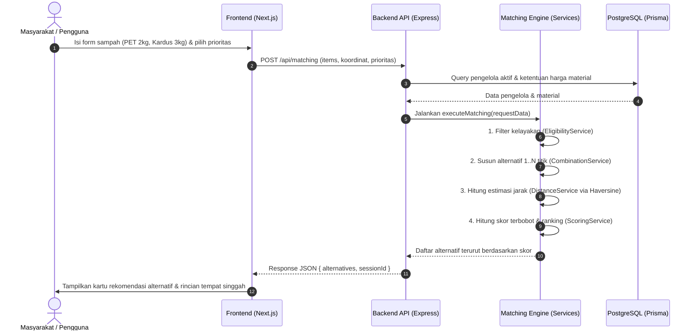

# PANDUAN STRUKTUR DAN ARSITEKTUR PROYEK SAMPAHHUB

Dokumen ini mendokumentasikan rancangan arsitektur dan struktur folder lengkap untuk **Backend** (Express.js + TypeScript) dan **Frontend** (Next.js 16 App Router + Tailwind CSS) pada aplikasi **SampahHub**, sesuai dengan spesifikasi produk pada [Dokumentasi_SampahHub.md](./Dokumentasi_SampahHub.md).

---

## 1. Arsitektur Backend (`backend/`)

Backend menggunakan pola **Layered Architecture (Controller – Service – Model/Database)** yang terorganisasi secara **modular per domain bisnis**. Pemisahan ini memastikan logika bisnis yang kompleks (terutama *Matching Engine*) terisolasi dari kontroler HTTP dan mudah diuji.

### 1.1 Diagram Pohon Folder Backend

```text
backend/
├── prisma/
│   └── schema.prisma                # Skema database PostgreSQL (Bab 11 Dokumentasi)
├── src/
│   ├── config/                      # Konfigurasi aplikasi & database
│   │   ├── database.ts              # Inisialisasi client database
│   │   └── env.ts                   # Manajemen environment variable terpusat
│   ├── middlewares/                 # Middleware Express
│   │   ├── auth.middleware.ts       # Verifikasi token autentikasi (JWT)
│   │   ├── role.middleware.ts       # Guard hak akses peran (user, recycler, admin)
│   │   ├── validate.middleware.ts   # Validasi request body (Zod)
│   │   └── error.middleware.ts      # Global error handler
│   ├── modules/                     # Modular per domain bisnis
│   │   ├── auth/                    # Modul Registrasi & Login
│   │   │   ├── auth.controller.ts
│   │   │   ├── auth.service.ts
│   │   │   └── auth.routes.ts
│   │   ├── waste/                   # Modul Master Kategori Sampah
│   │   │   ├── waste.controller.ts
│   │   │   ├── waste.service.ts
│   │   │   └── waste.routes.ts
│   │   ├── recyclers/               # Modul Profil Pengelola & Material
│   │   │   ├── recycler.controller.ts
│   │   │   ├── recycler.service.ts
│   │   │   └── recycler.routes.ts
│   │   ├── matching/                # INTI FITUR: Mesin Pencocokan Multi-Material
│   │   │   ├── matching.controller.ts
│   │   │   ├── matching.routes.ts
│   │   │   └── services/            # Sub-layanan logika algoritma pencocokan
│   │   │       ├── matching.service.ts       # Orchestrator alur pencocokan
│   │   │       ├── eligibility.service.ts    # Filter kelayakan material & min kuantitas
│   │   │       ├── combination.service.ts    # Penyusunan alternatif 1..N pengelola
│   │   │       ├── distance.service.ts       # Kalkulasi jarak rute & titik singgah
│   │   │       └── scoring.service.ts        # Normalisasi skor (E, D, S) & bobot prioritas
│   │   └── admin/                   # Modul Verifikasi & Audit Platform
│   │       ├── admin.controller.ts
│   │       ├── admin.service.ts
│   │       └── admin.routes.ts
│   ├── utils/                       # Utilitas & helper pendukung
│   │   ├── haversine.ts             # Fungsi hitung jarak garis lurus koordinat bumi
│   │   └── api-response.ts          # Standarisasi format response JSON API
│   ├── types/
│   │   └── index.ts                 # Definisi tipe TypeScript backend
│   ├── app.ts                       # Setup middleware Express & pendaftaran rute
│   └── server.ts                    # Entry point listener server
├── .env.example
├── package.json
└── tsconfig.json
```

---

### 1.2 Rincian Fungsi Tiap File & Folder Backend

#### A. Konfigurasi (`src/config/`)
| File | Fungsi |
| :--- | :--- |
| `env.ts` | Membaca dan memvalidasi environment variable seperti `PORT`, `DATABASE_URL`, dan `JWT_SECRET`. |
| `database.ts` | Menyiapkan koneksi client database (Prisma / PostgreSQL) agar dapat di-reuse oleh service. |

#### B. Middlewares (`src/middlewares/`)
| File | Fungsi |
| :--- | :--- |
| `auth.middleware.ts` | Mengecek validitas token JWT pada header `Authorization` sebelum request diproses. |
| `role.middleware.ts` | Memastikan hanya role tertentu (misal: hanya `admin` atau `recycler`) yang dapat mengakses rute sensitif. |
| `validate.middleware.ts` | Memvalidasi integritas payload input menggunakan skema Zod sebelum masuk ke controller. |
| `error.middleware.ts` | Menangkap seluruh unhandled error di Express dan mengembalikan response error JSON yang aman dan seragam. |

#### C. Modul Domain (`src/modules/`)
* **Modul `auth/`:**
  * `auth.controller.ts`: Menerima request HTTP untuk registrasi dan login.
  * `auth.service.ts`: Logika enkripsi password, query akun, dan pembuatan token JWT.
  * `auth.routes.ts`: Rute `POST /api/auth/register` dan `POST /api/auth/login`.
* **Modul `waste/`:**
  * `waste.controller.ts`: Handler HTTP untuk data kategori sampah.
  * `waste.service.ts`: Mengambil daftar kategori resmi (botol PET, kardus, jelantah, kertas, logam) dari database.
  * `waste.routes.ts`: Rute `GET /api/waste/categories`.
* **Modul `recyclers/`:**
  * `recycler.controller.ts`: Handler untuk direktori pengelola dan detail profil.
  * `recycler.service.ts`: Query data pengelola aktif beserta ketentuan harga material yang diterima.
  * `recycler.routes.ts`: Rute `GET /api/recyclers` dan `GET /api/recyclers/:id`.
* **Modul `matching/` (Logika Inti Produk):**
  * `matching.controller.ts`: Handler request pencocokan multi-material dari pengguna.
  * `matching.routes.ts`: Rute `POST /api/matching`.
  * `services/matching.service.ts`: Mengorkestrasi 4 sub-servis (Eligibility $\rightarrow$ Combination $\rightarrow$ Distance $\rightarrow$ Scoring) lalu mengurutkan alternatif hasil.
  * `services/eligibility.service.ts`: Memeriksa apakah status pengelola aktif, kategori diterima, kuantitas memenuhi `min_quantity`, dan kualitas material sesuai (Bab 9.3).
  * `services/combination.service.ts`: Menyusun skenario pembagian material ke 1 pengelola tunggal atau partisi 2..N pengelola (Bab 9.5).
  * `services/distance.service.ts`: Menghitung jarak pengguna ke titik-titik pengelola dan total rute antar-titik singgah (Bab 9.6).
  * `services/scoring.service.ts`: Menghitung skor nilai ekonomi ($E$), kedekatan jarak ($D$), efisiensi titik ($S$), serta pembobotan sesuai prioritas (*Balanced*, *Highest Value*, *Nearest*, *Fewest Stops*) (Bab 9.7).
* **Modul `admin/`:**
  * `admin.controller.ts`: Handler tindakan administratif (verifikasi/penolakan mitra).
  * `admin.service.ts`: Memperbarui status verifikasi pengelola (`pending`, `verified`, `rejected`) di database.
  * `admin.routes.ts`: Rute `POST /api/admin/recyclers/:id/verify`.

#### D. Utilitas & Database
| File / Folder | Fungsi |
| :--- | :--- |
| `src/utils/haversine.ts` | Mengimplementasikan rumus trigonometri Haversine untuk estimasi jarak garis lurus berbasis koordinat latitude & longitude. |
| `src/utils/api-response.ts` | Helper `sendSuccess` dan `sendError` agar format response JSON selalu seragam: `{ status, message, data }`. |
| `prisma/schema.prisma` | Definisi skema tabel database PostgreSQL lengkap sesuai BAB 11: `users`, `recyclers`, `waste_categories`, `recycler_materials`, `matching_sessions`, `matching_items`, `matching_results`, `matching_assignments`, dan `price_histories`. |

---

## 2. Arsitektur Frontend (`frontend/`)

Frontend dibangun menggunakan **Next.js 16 App Router** dengan pengelompokan rute menggunakan fitur **Route Groups `(...)`** agar layout masing-masing bagian (Publik, Alur Matching, Dashboard Mitra, Dashboard Admin) terisolasi dengan rapi tanpa mengubah URL di browser.

### 2.1 Diagram Pohon Folder Frontend

```text
frontend/
├── app/
│   ├── (auth)/                      # Rute Autentikasi
│   │   ├── login/page.tsx           # Halaman Form Login
│   │   ├── register/page.tsx        # Halaman Form Registrasi (Pilihan: Warga / Mitra)
│   │   └── layout.tsx               # Layout kartu auth terpusat
│   ├── (public)/                    # Rute Terbuka untuk Publik
│   │   ├── recyclers/
│   │   │   ├── page.tsx             # Direktori Pencarian Pengelola
│   │   │   └── [id]/page.tsx        # Halaman Detail Profil & Daftar Harga Pengelola
│   │   ├── categories/page.tsx      # Edukasi Jenis Sampah & Syarat Pemilahan
│   │   └── layout.tsx               # Layout publik dengan navigasi umum
│   ├── (matching)/                  # Alur Mesin Pencocokan (Masyarakat)
│   │   ├── match/
│   │   │   ├── page.tsx             # Form Input Multi-Material & Pilihan Prioritas
│   │   │   └── results/[sessionId]/ # Halaman Hasil Rekomendasi & Rincian Rute
│   │   │       └── page.tsx
│   │   └── layout.tsx               # Layout khusus alur matching
│   ├── (dashboard)/                 # Area Terproteksi (Dashboard Pengguna)
│   │   ├── recycler/                # Panel Mitra Pengelola Sampah
│   │   │   ├── layout.tsx           # Sidebar navigasi pengelola
│   │   │   ├── page.tsx             # Overview metrik pengelola
│   │   │   ├── profile/page.tsx     # Pengaturan alamat & koordinat peta pengelola
│   │   │   └── materials/page.tsx   # Kelola material diterima, harga, & min kuantitas
│   │   └── admin/                   # Panel Administrator SampahHub
│   │       ├── layout.tsx           # Sidebar navigasi admin
│   │       ├── page.tsx             # Ringkasan sistem & audit
│   │       ├── verifications/       # Antrean verifikasi pengelola baru
│   │       │   └── page.tsx
│   │       ├── categories/page.tsx  # CRUD Master Kategori Sampah
│   │       └── price-audit/page.tsx # Pemantauan tanggal pembaruan harga pengelola
│   ├── globals.css                  # Konfigurasi Tailwind CSS
│   ├── layout.tsx                   # Root HTML & body layout
│   └── page.tsx                     # Landing Page Utama SampahHub
├── components/                      # Komponen UI Reusable
│   ├── ui/                          # Komponen atomik (Button, Badge, Input, Card)
│   ├── maps/                        # Komponen peta Leaflet (OpenStreetMap)
│   ├── matching/                    # Form row multi-material & selector prioritas
│   ├── layout/                      # Navbar, Sidebar, Footer
│   └── shared/                      # DemoBanner ("PERINGATAN: DATA DEMO")
├── lib/                             # Utilitas & Client Lib
│   ├── api-client.ts                # Fetch wrapper terpusat untuk memanggil backend
│   ├── constants.ts                 # Label tipe pengelola, opsi prioritas, bobot skor
│   └── utils.ts                     # Formatter angka rupiah & format jarak (km/m)
├── types/
│   └── index.ts                     # Definisi kontrak tipe data TypeScript frontend
├── .env.example
├── package.json
└── tsconfig.json
```

---

### 2.2 Rincian Fungsi Tiap File & Folder Frontend

#### A. Rute Aplikasi (`app/`)
| Rute | File | Fungsi |
| :--- | :--- | :--- |
| `/` | `app/page.tsx` | Landing page utama pengenalan proposisi nilai SampahHub, langkah kerja, dan call-to-action (CTA). |
| `/login` | `app/(auth)/login/page.tsx` | Antarmuka masuk akun bagi masyarakat, mitra pengelola, atau admin. |
| `/register` | `app/(auth)/register/page.tsx` | Formulir pendaftaran akun dengan pemilihan jenis peran. |
| `/recyclers` | `app/(public)/recyclers/page.tsx` | Direktori pencarian mitra pengelola dengan filter tipe institusi (Bank Sampah, Pengepul, TPS3R, Industri). |
| `/recyclers/:id` | `app/(public)/recyclers/[id]/page.tsx` | Profil lengkap satu pengelola, kontak, lokasi, dan daftar harga beli materialnya. |
| `/categories` | `app/(public)/categories/page.tsx` | Halaman edukasi jenis sampah daur ulang, kisaran harga pasar, dan tips pemilahan. |
| `/match` | `app/(matching)/match/page.tsx` | **Fitur Utama Warga:** Form dinamis untuk input 1–5 jenis sampah, kuantitas, satuan, lokasi GPS, dan 4 pilihan prioritas pencarian. |
| `/match/results/:sessionId` | `app/(matching)/match/results/[sessionId]/page.tsx` | **Halaman Hasil:** Menampilkan perbandingan kartu alternatif rekomendasi, rincian tempat singgah (stops), rincian pendapatan rupiah, dan skor. |
| `/recycler` | `app/(dashboard)/recycler/page.tsx` | Beranda ringkasan status penerimaan dan status verifikasi mitra. |
| `/recycler/profile` | `app/(dashboard)/recycler/profile/page.tsx` | Form pengaturan profil usaha, alamat, dan pin koordinat peta. |
| `/recycler/materials` | `app/(dashboard)/recycler/materials/page.tsx` | Form pengaturan harga per satuan, batas minimum setoran, dan syarat kualitas material. |
| `/admin` | `app/(dashboard)/admin/page.tsx` | Dashboard ringkasan metriks platform. |
| `/admin/verifications` | `app/(dashboard)/admin/verifications/page.tsx` | Tabel verifikasi calon mitra pengelola (`pending` $\rightarrow$ `verified` / `rejected`). |
| `/admin/categories` | `app/(dashboard)/admin/categories/page.tsx` | Manajemen master data kategori sampah dan satuan baku. |
| `/admin/price-audit` | `app/(dashboard)/admin/price-audit/page.tsx` | Pantauan pengelola yang belum memperbarui harga melewati batas waktu tertentu. |

#### B. Komponen Reusable (`components/`)
| Folder | Komponen | Fungsi |
| :--- | :--- | :--- |
| `components/shared/` | `DemoBanner.tsx` | Menampilkan banner wajib transparansi: **"DATA DEMO / SIMULASI"** pada MVP sesuai instruksi BAB 14 & 16. |
| `components/layout/` | `Navbar.tsx` | Header navigasi global dengan link rute cepat dan status user. |
| `components/ui/` | `Badge.tsx` | Label status kecil (contoh: badge `DEMO`, status `Terverifikasi`, `Menunggu Verifikasi`). |
| `components/matching/` | `WasteItemInput.tsx` | Satu baris komponen input material (dropdown kategori, input angka, auto-satuan, catatan mutu, tombol hapus baris). |
| `components/matching/` | `PrioritySelector.tsx` | Komponen radio/card interaktif untuk memilih 4 mode prioritas (*Balanced*, *Highest Value*, *Nearest*, *Fewest Stops*). |
| `components/maps/` | `LeafletMap.tsx` | Komponen penampil peta OpenStreetMap untuk rute setoran (di-load via dynamic import tanpa SSR). |

#### C. Library & Tipe Data (`lib/` & `types/`)
| File | Fungsi |
| :--- | :--- |
| `lib/api-client.ts` | Wrapper pemanggilan `fetch` terpusat yang otomatis menangani base URL backend dan header JSON. |
| `lib/constants.ts` | Menyimpan label statis tipe pengelola (`bank_sampah`, `pengepul`, dll.), opsi prioritas, dan batas kuantitas. |
| `lib/utils.ts` | Helper format mata uang (`formatRupiah`), jarak (`formatDistance`), dan format tanggal Indonesia. |
| `types/index.ts` | Interface TypeScript untuk entitas data: `User`, `Recycler`, `WasteCategory`, `RecyclerMaterial`, `MatchingAlternative`, `StopAllocation`. |

---

## 3. Alur Komunikasi Data Antara Frontend & Backend



---

## 4. Cara Menjalankan Project (Local Development)

### 4.1 Menjalankan Backend
```bash
cd backend
npm install
npm run dev
```
* Server berjalan di: `http://localhost:5000`
* Cek status server: `http://localhost:5000/api/health`
* Pengecekan tipe TypeScript:
  ```bash
  npx tsc --noEmit
  ```

### 4.2 Menjalankan Frontend
```bash
cd frontend
npm install
npm run dev
```
* Aplikasi berjalan di: `http://localhost:3000`
* Pengecekan tipe TypeScript:
  ```bash
  npx tsc --noEmit
  ```

